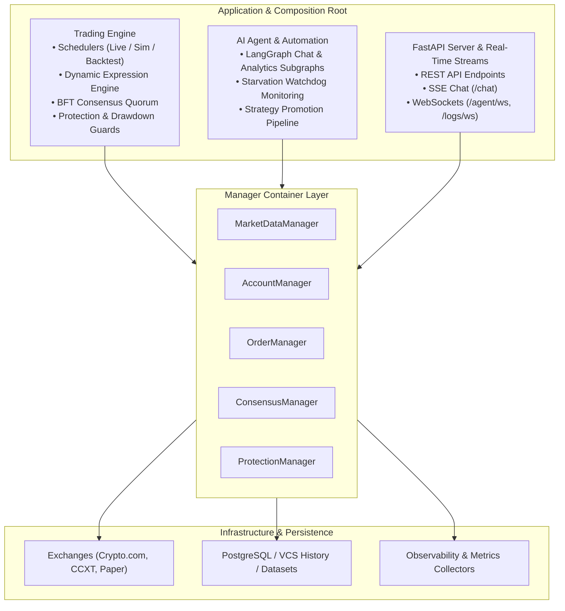

# MCT Trading Bot

[](https://github.com/toniton/ml-crypto-trading/actions/workflows/ci.yml)
[](https://github.com/pylint-dev/pylint)
[](https://codecov.io/github/toniton/ml-crypto-trading)
[](https://github.com/pre-commit/pre-commit)
[](LICENSE.txt)
[](https://hub.docker.com/r/toniton/ml-crypto-trading)
[](https://discord.gg/vZh8w3Sz)

MCT (stands for ML-Crypto-Trading) is a high-performance trading engine that features a **Dynamic Expression Engine**
allowing users to define position sizing and risk management logic using familiar, spreadsheet-like functions.

> [!TIP]
> **Financial Logic Without the Code.**
> If you can write an Excel-style formula, you can define trading logic in MCT. The engine provides access to real-time
> market data, balances, and technical indicators (RSI, EMA, SMA) directly in your configuration.

> Caveat Utilitor! For educational and research purposes only.

---

## Community

Join our Discord community to discuss strategies, report issues, and collaborate with other traders:

[](https://discord.gg/vZh8w3Sz)


---

## Table of Contents

- [Quick Start](#quick-start)
- [Core Features](#core-features)
- [Architecture](#architecture)
- [Dynamic Expressions](#dynamic-expressions)
- [Strategy Promotion Pipeline](#strategy-promotion-pipeline)
- [Run Modes](#run-modes)
- [Makefile Commands Reference](#makefile-commands-reference)
- [Documentation Hub](#documentation)
- [Community & License](#community)

---

## Quick Start

The bot can be run using **Make / standard Python** or **Docker**.

### Prerequisites

- **Python 3.11+** (Python 3.12 recommended)
- **PostgreSQL**: A running instance (local Docker, native service, or remote like **Supabase**, **Neon**, **AWS RDS**).
- **Operating System**: macOS, Linux, or Windows (PowerShell, WSL, or Git Bash).

### Interactive CLI Setup Wizard (Recommended)

Launch the guided interactive terminal installer to configure your environment, provision the PostgreSQL database, setup exchange & LLM credentials, install dependencies, and run database migrations:

**macOS / Linux:**
```bash
./install.sh
# Or via Make
make install-interactive
```

**Windows (PowerShell):**
```powershell
.\install.ps1
```

> **Automated / CI/CD Mode**: Run unattended with defaults or specific profiles:
> ```bash
> ./install.sh --non-interactive --profile=quickstart
> # Simulate without writing files
> ./install.sh --dry-run
> ```

> 📖 *For traditional step-by-step setup scripts, manual `.env` configuration, database migration commands, and automated CI profiles, see the full [Installation & Setup Guide](docs/installation.md).*

---

## Core Features

- **Dynamic Expression Engine**: Define custom position sizing formulas and strategy triggers directly in YAML using spreadsheet-style syntax with access to real-time indicators (`rsi`, `sma`, `ema`), account equity, and market state.
- **BFT Consensus Engine**: Byzantine Fault Tolerant multi-strategy decision engine supporting flexible voting models, including single-strategy execution, independent OR triggers, and strict multi-strategy consensus.
- **High-Fidelity Backtesting**: Multi-asset historical simulation featuring independent virtual clocks, realistic execution frictions (configurable latency, tick slippage, fee rates), and deterministic tick replay.
- **Strategy Promotion Pipeline**: Guarded verification pipeline that evaluates proposed configuration adjustments against historical simulations, checks for execution drift, and enforces quantitative safety criteria before live deployment.
- **Autonomous Activity Monitoring**: Background starvation watchdog continuously tracks per-asset market data, evaluations, signals, and executions, proactively flagging trading inactivity without manual intervention.
- **AI Agent System**: LangGraph-powered conversational assistant with specialized subgraphs for configuration tuning, on-demand backtesting, performance analytics, and human-in-the-loop approvals.
- **Configuration Version Control (VCS)**: Git-like content-addressable history tracking for runtime configurations, providing cryptographic audit trails, branch management, and instant rollbacks.
- **Runtime Observability & Telemetry**: Built-in collectors for system resources, WebSocket connection health, order lifecycle latencies, execution attribution, and live log streaming.

> *For motivation, system architecture, and deep-dive conceptual guides, see [Introduction & Features](docs/introduction.md) and [Core Concepts](docs/concepts.md).*

---

## Architecture

MCT is built with a modular, decoupled architecture separating execution loops, trading logic, AI agent automation, and transport APIs:



> 📖 *For complete component breakdown, manager containers, and sequence diagrams, see [Architecture & Diagrams](docs/architecture.md) and [Agent Automation & Monitoring](docs/agent-automation.md).*

---

## Dynamic Expressions

MCT features a spreadsheet-style formula engine allowing traders to define algorithmic signals and dynamic order sizing directly in YAML without writing Python code:

```yaml
# Dynamic position sizing (e.g. risk 2% of equity per trade)
dynamic_quantity: "max(min_qty, (balance * 0.02) / close)"

# Dynamic strategy trigger expression
expression: "rsi(14) < 30 and close > ema(20)"
```

Expressions evaluate in real time with access to:
- **Market Data**: `close`, `high`, `low`, `volume`, `range`
- **Account State**: `balance`, `equity`, `pnl` (unrealized), `position_qty`
- **Technical Indicators**: `rsi(period)`, `sma(period)`, `ema(period)`, `min(...)`, `max(...)`, `avg(...)`
- **Signal & Quorum**: `signal`, `confidence`, `vote_ratio`

> 📖 *For complete indicator functions, formula syntax, and full configuration schema, see [Dynamic Expressions in Core Concepts](docs/concepts.md#dynamic-expressions) and the [Configuration Guide](docs/configuration.md).*

---

## Strategy Promotion Pipeline

The bot features an automated, guarded pipeline for testing and safely promoting strategy adjustments from simulation into live trading:

- **Baseline Performance Comparison**: Evaluates candidate configurations against active production benchmarks across return, Sharpe ratio, and max drawdown.
- **Execution Drift Protection**: Validates that simulated order fills and execution latencies do not diverge from live journal observations.
- **Safety Policy Gating**: Enforces quantitative criteria via `PromotionPolicy` before allowing human-in-the-loop approval and VCS staging.

> 📖 *For simulation telemetry details, gating thresholds, and API endpoints, see the [Strategy Promotion Pipeline Guide](docs/strategy-promotion.md).*

---

## Makefile Commands Reference

| Command | Description |
| :--- | :--- |
| `make install-interactive` | Launch guided interactive CLI setup wizard |
| `make setup` | Bootstrap virtualenv, install dependencies, init `.env`, and setup git hooks |
| `make venv` | Create virtual environment and install development dependencies |
| `make install` | Install production requirements (`requirements.txt`) |
| `make install-dev` | Install development requirements (`requirements-dev.txt`) |
| `make clean` | Clean virtualenv, pytest cache, coverage files, and python bytecode |
| `make db-setup` | Check database environment (PostgreSQL / Docker) and readiness |
| `make db-up` | Start PostgreSQL container via `docker compose` |
| `make db-down` | Stop PostgreSQL container |
| `make upgrade` | Apply pending Alembic migrations (`alembic upgrade head`) |
| `make downgrade` | Rollback database migrations to base |
| `make migrate` | Generate a new Alembic migration revision (`make migrate m="my migration"`) |
| `make format` | Run pre-commit hooks and code formatters |
| `make lint` | Run pylint checks |
| `make test` | Run pytest suite with code coverage |
| `make run-simulated` | Run paper trading in simulated mode |
| `make run-backtest` | Run historical backtesting simulation |
| `make run-live` | Run live trading engine (with integrated API server) |
| `make run-headless` | Run live trading in headless mode (API server disabled) |

---

## Run Modes

MCT supports multiple execution modes for paper trading, historical simulation, live execution, and headless daemon operation:

| Mode | Purpose | Make Target | Key CLI Flags |
| :--- | :--- | :--- | :--- |
| **Simulated Trading** | Real-time market feed with in-memory simulated order execution | `make run-simulated` | `--simulated=true` |
| **Backtesting** | Historical tick / CSV replay with latency, slippage, and fee modeling | `make run-backtest` | `--backtest-mode=true --backtest-source=...` |
| **Live Trading** | Real exchange orders + integrated FastAPI & Agent server | `make run-live` | `--assets-conf=trading-config.yaml` |
| **Headless Daemon** | Production trading engine running without web/API overhead | `make run-headless` | `--headless=true` |
| **API Server Only** | Interactive chat, metric APIs, and WebSocket streams | `python main.py --server=true` | `--server=true --api-port=8000` |

> *For complete CLI flags, Docker container commands, execution friction parameters (latency, slippage, fees), and audit log replays, see the comprehensive [Run Modes Guide](docs/run-modes.md).*

---

## Documentation

For in-depth guides, architectural blueprints, and API references, browse the documentation in the [docs/](docs/README.md) directory:

- [**Documentation Hub**](docs/README.md) — Central portal, reading tracks, and full index.
- [**Installation & Setup Guide**](docs/installation.md) — Interactive CLI wizard (`install.sh`), automated profiles, and database configuration.
- [**Run Modes Guide**](docs/run-modes.md) — Simulated paper trading, historical backtesting, live execution, and headless daemons.
- [**Configuration & System Properties**](docs/configuration.md) — CLI flags, environment variables, and YAML configuration schemas.
- [**Introduction & Features**](docs/introduction.md) — Architectural motivation and core capability breakdown.
- [**Core Concepts**](docs/concepts.md) — BFT Consensus model, Dynamic Expressions syntax, backtesting frictions, and VCS history.
- [**Strategy Promotion Pipeline**](docs/strategy-promotion.md) — Simulation replay, baseline comparison, drift checks, and VCS staging.
- [**Agent Automation & Monitoring**](docs/agent-automation.md) — Starvation Watchdog, event bus contracts, safety authority, and approvals.
- [**REST API & WebSocket Reference**](docs/api.md) — Comprehensive HTTP endpoint catalog, schemas, and WebSocket streaming protocols.
- [**Architecture & Diagrams**](docs/architecture.md) — Manager container layer, LangGraph subgraphs, and component boundaries.
- [**Logging Architecture**](docs/logging.md) — Application and trading logs, consensus debug formatting, and audit replay.
- [**Data Retention Policy & Inventory**](docs/retention-inventory.md) — Table retention rules, TTL cleanup, and database storage management.
- [**Benchmarks & Evaluation**](docs/benchmarks/rio-20q-baseline.md) — 20q and 50q evaluation baselines and LLM decision grading.
- [**Community & Contributing**](docs/community.md) — Contributing guidelines, pull requests, and Discord community.

---

## License & Commercial Terms

This project is source-available under the **[PolyForm Noncommercial License 1.0.0](LICENSE.txt)**.

- **Free for Personal & Educational Use**: You are free to view, download, modify, and run this software for non-commercial purposes, personal trading research, and learning.
- **Commercial Restrictions**: Any commercial use, proprietary trading for profit by institutions or funds, hosting MCT as a commercial service/SaaS, or selling software built on MCT requires a separate commercial license from the author.

For commercial licensing inquiries or institutional partnerships, please reach out via [Discord](https://discord.gg/vZh8w3Sz) or open a private inquiry.

## Copyright
Copyright © 2026 Toni Akinjiola. All rights reserved.
