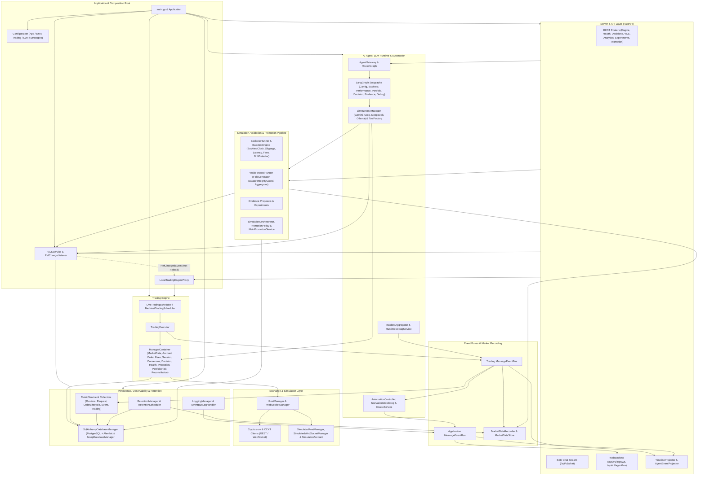
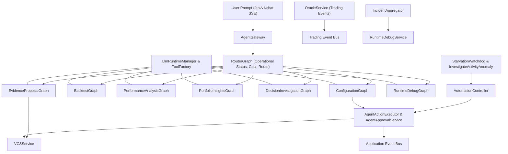

# Architecture

## High-Level System Architecture

## Trading Execution Tick Pipeline

Each scheduled asset tick flows deterministically through `TradingExecutor`, recording a full `TradingDecision` snapshot whether the signal is executed or rejected:

```mermaid
flowchart LR
    Tick["Scheduler Tick"] --> Market["MarketDataManager & MarketRegimeDetector"]
    Market --> Health["HealthMonitor (TradingPermission)"]
    Health --> Strategies["StrategyRegistry & StrategyResolver"]
    Strategies --> Consensus["ConsensusManager (Weighted Quorum)"]
    Consensus --> Sizing["PositionSizer (Dynamic Expressions & Regime Sizing)"]
    Sizing --> Risk["ProtectionManager & PortfolioRiskManager"]
    Risk --> Decision["DecisionManager (Persist TradingDecision)"]
    Decision --> Order["OrderManager & FeesManager"]
    Order --> Exchange["RestManager / WebSocketManager"]
    Decision --> Bus["Trading MessageEventBus"]
    Order --> Bus
```

## AI Agent & Automation Flow

Interactive chat requests and autonomous background monitors share the same VCS, approval, and event infrastructure:

## Core Subsystems

The application follows a modular, decoupled architecture adhering to strict separation of concerns.

### Application & Composition Root
- **`Application` (`src/application.py`)**: Coordinates startup, configuration bootstrapping (`EnvironmentConfig`, `ApplicationConfig`, `TradingConfig`, `LlmConfig`, `StrategiesConfig`), database initialization, manager instantiation, strategy and guard registration, headless/backtest mode branching, and graceful shutdown.
- **`VCSService` & `RefChangeListener` (`src/vcs/`)**: Content-addressable configuration storage in PostgreSQL supporting branches, diffs, semantic merges, commit history, runtime checkout/rollback, and live hot-reload via `RefChangedEvent`.
- **`LocalTradingEngineProxy` (`src/trading/local_trading_engine_proxy.py`)**: Mediates API and service interactions with `TradingEngine`, `MarketDataStore`, and backtest drift comparison.

### Trading Engine
- **Trading Schedulers**: Control asset evaluation cadences:
  - `LiveTradingScheduler`: Driven by wall-clock intervals across configured asset timeframes.
  - `BacktestTradingScheduler`: Driven by virtual `BacktestClock` instances stepping through historical bars as fast as CPU permits.
- **`TradingExecutor` (`src/trading/trading_executor.py`)**: Core per-asset evaluation loop:
  1. Pulls candle and ticker data via `MarketDataManager` and classifies market conditions via `MarketRegimeDetector`.
  2. Checks system and asset trading permissions via `HealthMonitor`.
  3. Resolves and evaluates configured strategies via `StrategyRegistry` / `StrategyResolver`, aggregating weighted votes through `ConsensusManager`.
  4. Computes target position sizes via `PositionSizer` (dynamic expressions and regime-aware sizing).
  5. Enforces asset-level safety guards (`ProtectionManager`) and portfolio-level exposure/reserve limits (`PortfolioRiskManager`).
  6. Persists structured `TradingDecision` snapshots via `DecisionManager` and dispatches orders through `OrderManager`.

### Manager Layer (`ManagerContainer`)
- **`MarketDataManager`**: Aggregates real-time feeds, historical candle bars, and market state.
- **`AccountManager`**: Tracks multi-asset balances and synchronizes account equity.
- **`OrderManager`**: Manages order lifecycle state, execution journals, and exchange order dispatch.
- **`FeesManager` & `SessionManager`**: Tracks fee structures, trading sessions, and active VCS commit hashes.
- **`ConsensusManager`**: Evaluates multi-strategy weighted quorum voting.
- **`DecisionManager`**: Records complete audit snapshots of every trading decision and rejection reason.
- **`HealthMonitor`**: Tracks component and trading health state machines (`TradingPermission`).
- **`ProtectionManager` & `PortfolioRiskManager`**: Enforces asset guards (drawdown, cooldowns, circuit breakers) and portfolio-wide risk policies.
- **`ExchangeReconciliationEngine`**: Continuously reconciles local state against exchange state and automatically triggers on WebSocket reconnects.
- **`RestManager` & `WebSocketManager`**: Abstracts exchange communication across registered live and simulated clients.

### Exchange & Simulation Layer
- **Live Clients (`src/exchange/clients/`)**: Native **Crypto.com** REST/WebSocket clients (with auth and heartbeat handlers) and **CCXT** REST/WebSocket adapters.
- **Paper Simulation (`src/simulation/`)**: `SimulatedRestManager`, `SimulatedWebSocketManager`, and `SimulatedAccount` for simulated execution without live exchange orders.

### Event Buses, Projections & Market Recording
- **Dual `MessageEventBus` (`src/events/`)**: Separates trading/market/decision events (`_trading_event_bus`) from application/agent/log/VCS events (`_event_bus`).
- **Projectors & Recorders**: `TimelineProjector`, `AgentEventProjector`, `AssetActivityTracker`, and `MarketDataRecorder` (persisting market ticks into `MarketDataStore` for replay and backtesting).

### AI Agent, LLM Runtime & Automation Subsystem
- **`LlmRuntimeManager` & `ModelFactory` (`src/llm/`)**: Runtime-switchable LangChain adapters for **Gemini**, **Groq**, **DeepSeek**, and **Ollama**, paired with `ToolFactory` for trading, portfolio, metrics, VCS, backtest, walk-forward, and oracle tools.
- **`AgentGateway` & `RouterGraph` (`src/agent/`)**: Classifies natural language prompts and dispatches them to specialized LangGraph subgraphs registered in `AgentRegistry`:
  - `ConfigurationGraph`: Proposes strategy/config edits, validates expressions, computes diffs, and coordinates human-in-the-loop approvals.
  - `BacktestGraph`: Runs and analyzes on-demand historical simulations.
  - `PerformanceAnalysisGraph`: Analyzes order distributions, latency, and win-rates.
  - `PortfolioInsightsGraph`: Reviews mark-to-market equity, quote cash reserves, drawdowns, and concentration.
  - `DecisionInvestigationGraph`: Explains historical trading decisions and rejection causes.
  - `EvidenceProposalGraph`: Builds deterministic, evidence-backed strategy proposals (`src/proposals/`).
  - `RuntimeDebugGraph`: Diagnoses live runtime errors, order rejections, and exchange failures.
- **Autonomous Loops**:
  - `OracleService`: Emits proactive trading and market summaries from trading events.
  - `StarvationWatchdog`, `InvestigateActivityAnomaly`, `AutomationController`, `AgentActionExecutor`, & `AgentApprovalService`: Detects asset inactivity, runs drift checks, and manages gated automation actions.
  - `IncidentAggregator` & `RuntimeDebugService`: Aggregates runtime incidents and runs automated investigations.

### Backtesting, Walk-Forward & Strategy Promotion Pipeline
- **High-Fidelity Backtesting (`src/backtest/`)**: Multi-asset `BacktestRunner` and `BacktestEngine` driven by virtual `BacktestClock` instances with configurable slippage, latency, and fee models, supporting CSV and recorded `MarketDataStore` datasets, `BacktestDriftDetector`, and `NoopDatabaseManager` isolation.
- **Walk-Forward Validation (`src/walk_forward/`)**: `WalkForwardRunner`, `FoldGenerator`, `DatasetIntegrityGuard`, and `Aggregator` for out-of-sample fold validation.
- **Experiments & Evidence Proposals (`src/proposals/`, `src/server/services/`)**: Branch-based experiment tracking (`ExperimentApplicationService`) and deterministic proposal validation (`EvidenceEvaluator`, `ProposalValidator`).
- **Strategy Promotion Pipeline**: `SimulationOrchestrator`, `SimulationReportService`, `AssetPerformanceService`, `PromotionPolicy`, and `MainPromotionService` enforce quantitative gating before promoting candidate branches into `main` in VCS.

### Server & API Layer (FastAPI)
- **`ApiServer` & `ChatApp` (`src/server/`)**: Exposes modular REST routers for engine control, health, reconciliation, decisions, timeline, expressions, LLM runtime, agent actions, runtime debug, evidence proposals, experiments, walk-forward runs, strategy promotion, metrics, retention, VCS/configuration, backtests, datasets, conversations, and order analytics (heatmap, latency, daily/weekly orders, asset performance).
- **Real-Time Streams**: Server-Sent Events for conversational agent turns (`/api/v1/chat`), WebSocket log streaming (`/api/v1/logs/ws`), and WebSocket agent events (`/api/v1/agent/ws`).

### Persistence, Observability & Retention
- **Database (`src/database/`)**: `SqlAlchemyDatabaseManager` (PostgreSQL with Alembic migrations, tenant context, unit of work, and repositories) with `NoopDatabaseManager` fallback for isolated backtests.
- **Telemetry (`src/metrics/`)**: `MetricService` backed by `RuntimeMetricsCollector`, `RequestMetricsCollector` (`RequestMetricsMiddleware`), `OrderLifecycleCollector`, `EventMetricCollector`, and `TradingMetricsCollector`.
- **Logging (`src/logging/`)**: `LoggingManager` with `EventBusLogHandler` and domain mixins (application, trading, agent, audit).
- **Retention (`src/retention/`)**: `RetentionManager` and `RetentionScheduler` enforcing automated retention policies across database records and recorded market data.

---

## Configuration & Documentation Links

- [Documentation Index](README.md)
- [Introduction & Features](introduction.md)
- [Core Concepts](concepts.md)
- [Installation & Setup](installation.md)
- [Run Modes](run-modes.md)
- [Configuration & System Properties](configuration.md)
- [Strategy Promotion Pipeline](strategy-promotion.md)
- [Agent Automation & Monitoring](agent-automation.md)
- [REST API & WebSocket Reference](api.md)
- [Logging Architecture](logging.md)
- [Data Retention Inventory](retention-inventory.md)
