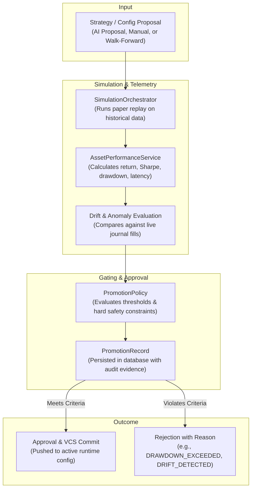

# Strategy Promotion Pipeline

The **Strategy Promotion Pipeline** provides an automated, guarded mechanism for validating, backtesting, and promoting trading strategy changes from research/simulation to live execution.

---

## 1. Motivation & Safety Principles

Modifying trading parameters or deploying new strategy logic directly to production risks capital loss and execution anomalies. 

The Strategy Promotion Pipeline enforces strict safety invariants:
1. **No Blind Promotions**: Every proposed configuration change must run through a high-fidelity simulation replay over recent market data before consideration.
2. **Deterministic Baseline Comparison**: Simulation metrics are scored against the existing production baseline (Sharpe ratio, max drawdown, win rate, total return).
3. **Execution Drift Protection**: Simulated order fills, slippage, and latency are evaluated against execution drift limits.
4. **VCS Tracking**: All approved promotions are committed content-addressably to the VCS history (`src/vcs/`), creating a cryptographically verifiable audit trail with instant rollback capabilities.

---

## 2. Architecture & Components



### Core Subsystems & Services

| Service | Location | Responsibility |
| :--- | :--- | :--- |
| `MainPromotionService` | `src/server/services/main_promotion_service.py` | Orchestrates the promotion workflow, coordinate runs, validates preconditions, and updates promotion records. |
| `SimulationOrchestrator` | `src/server/services/simulation_orchestrator.py` | Manages simulation runs, binds virtual clocks, instruments order simulation, and captures execution telemetry. |
| `PromotionPolicy` | `src/server/services/promotion_policy.py` | Encapsulates acceptance criteria (minimum return delta, maximum drawdown limits, required sample trades, win rate floors). |
| `AssetPerformanceService` | `src/server/services/asset_performance_service.py` | Calculates financial metrics, returns, equity curves, and performance attribution per asset. |
| `CanonicalConfigService` | `src/server/services/canonical_config.py` | Normalizes and validates configuration structures across versions and simulation runs. |
| `PromotionRepository` | `src/database/repositories/promotion_repository.py` | Persists promotion records, run metadata, and decision state in PostgreSQL. |

---

## 3. Promotion Policy & Evaluation Criteria

A promotion candidate is evaluated by `PromotionPolicy` against several quantitative checks:

- **Drawdown Limit**: Max drawdown during the simulation period must not exceed the baseline plus the configured safety margin.
- **Minimum Trade Count**: A strategy must produce sufficient statistically significant order executions over the test dataset.
- **Sharpe Ratio & Profit Factor**: The simulated Sharpe ratio must exceed the candidate minimum threshold.
- **Execution Drift**: Simulated slippage and timing must not diverge significantly from historical real-world fills for that asset.

### Status Transitions

```text
PENDING_SIMULATION ──► SIMULATING ──► EVALUATING ──┬──► PROMOTED (VCS Commit)
                                                   └──► REJECTED (Reason logged)
```

---

## 4. Promotion REST Endpoints

The promotion subsystem exposes endpoints for triggering simulations, checking evaluation status, and approving promotions:

| Method | Endpoint | Description |
| :--- | :--- | :--- |
| `POST` | `/api/v1/promotion/evaluate` | Submits a configuration candidate for simulated evaluation. |
| `GET`  | `/api/v1/promotion/candidates` | Lists all active promotion candidates and evaluation statuses. |
| `GET`  | `/api/v1/promotion/candidates/{id}` | Retrieves full performance metrics, simulation telemetry, and diff for a candidate. |
| `POST` | `/api/v1/promotion/candidates/{id}/decision` | Approves or rejects a promotion proposal. |
| `GET`  | `/api/v1/promotion/history` | Historical audit log of past promotions and rejections. |

---

## 5. UI Integration

The promotion pipeline integrates directly with the **Rio Trading Terminal** (`rio-trading-frontend`):
- **Promotion Management View**: Side-by-side metric comparisons between candidate configuration and active baseline.
- **Interactive Diff**: Visualizes YAML parameter changes alongside historical and simulated equity curves.
- **One-Click Approval**: Executes human-in-the-loop decisions with live progress feedback streamed via WebSocket.
